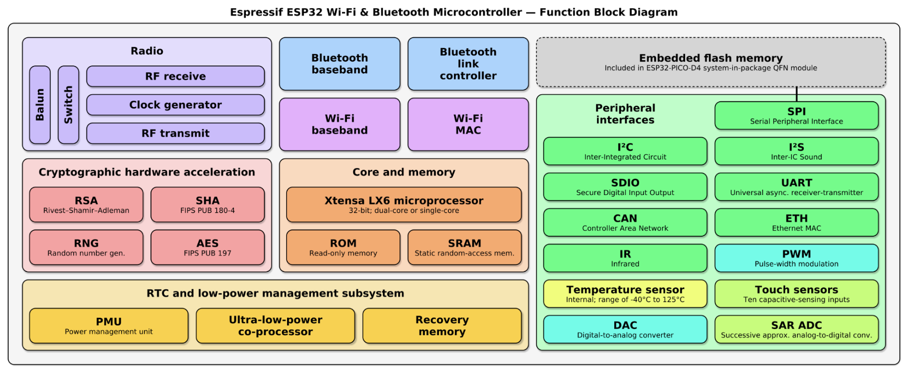
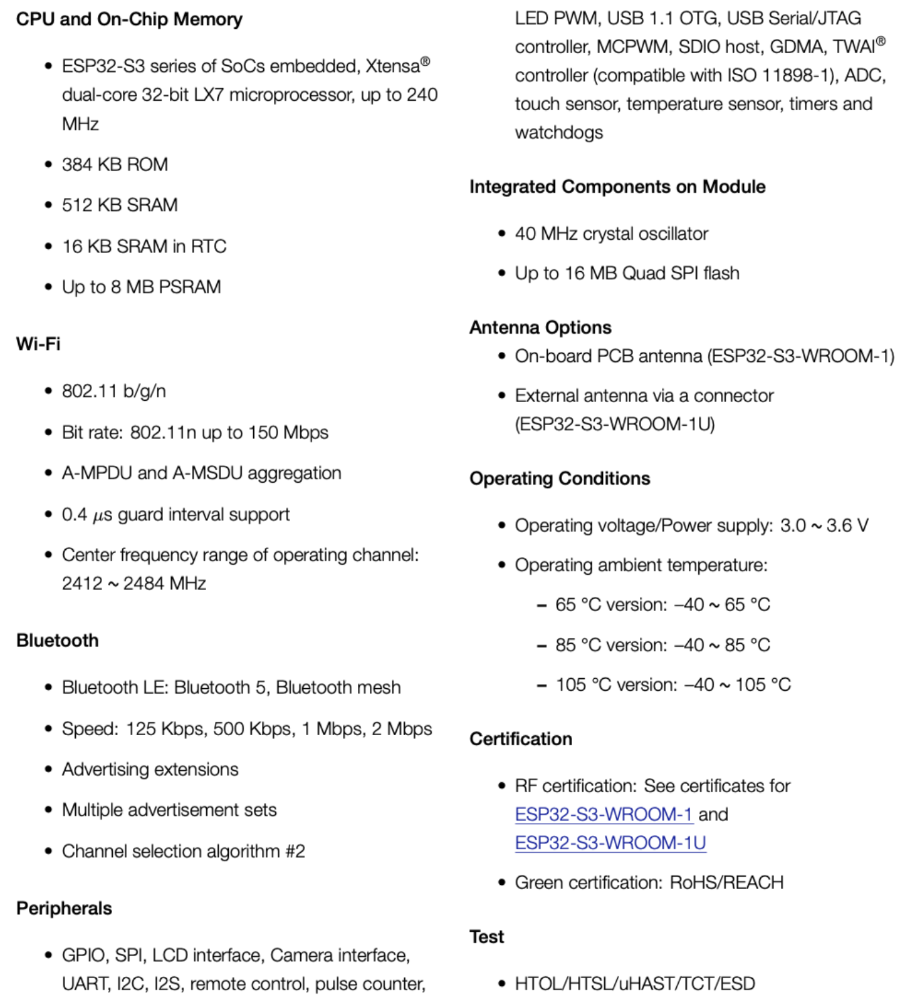
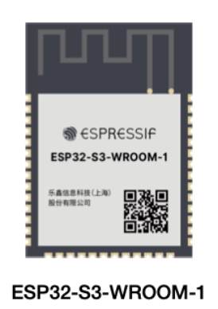
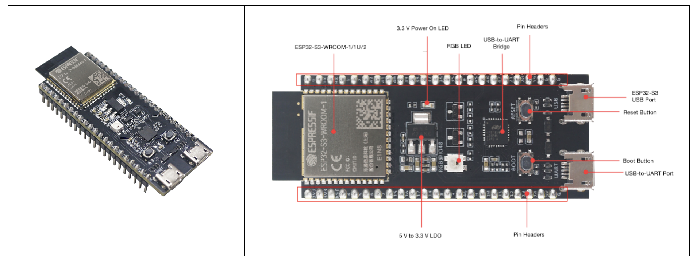
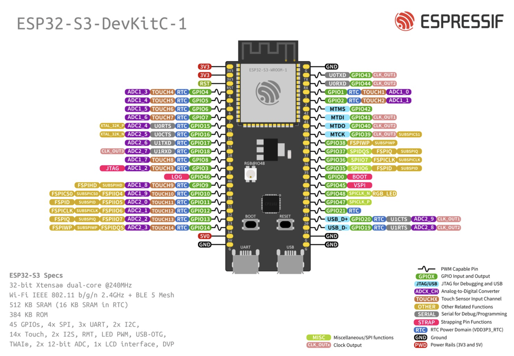
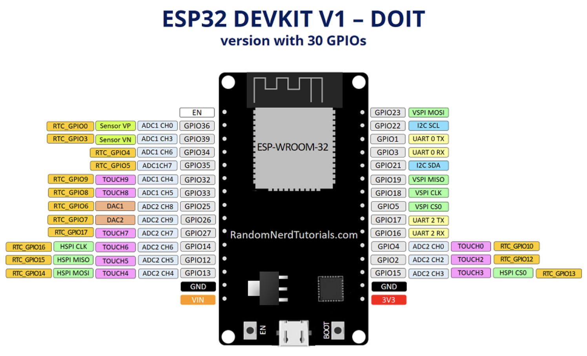

### Embedded Systems and IoT - ISI LT - a.y. 2026/2027

## Lab Activity #10 - 20261125

v. 1.0.0-20261117
 
### Working with ESP and RTOS

Working with SoCs: Introducing **ESP32-S3** and **ESP32-S3-DevKitC-1** board, included in the kit. 

Groups/students using an **ESP8266/NodeMCU** instead can find info here.  A main starting reference for  ESP8266 is the ESP8266 Community Forum

v. 1.0.0-20251202

### [ESP32 Family](https://en.wikipedia.org/wiki/ESP32)

- Series of low-cost, low-power system on a chip microcontrollers with integrated Wi-Fi and dual-mode Bluetooth.  
- Successor of the ESP8266 microcontroller, created and developed by Espressif Systems, a Shanghai-based Chinese company.  
- Employing Tensilica Xtensa LX6 microprocessor in both dual-core and single-core variations, Xtensa LX7 dual-core microprocessor or a single-core RISC-V microprocessor.  
- Includes built-in antenna switches, RF balun, power amplifier, low-noise receive amplifier, filters, and power-management modules. 
- Since the release of the original ESP32, a number of variants (ESP32-S2, ESP32-C3, ESP32-S3) have been introduced and announced (ESP32 family of microcontrollers), with different CPUs and capabilities.
  - All share the same SDK and are largely code-compatible. 



A nice and comprehensive ESP32 introduction is [here](https://randomnerdtutorials.com/getting-started-with-esp32/).

#### [ESP32-S3](https://www.espressif.com/en/products/socs/esp32-s3)

Features:




### From chips to boards

- Printed circuit boards - Surface-mount module boards
  - ESP32 based surface-mount printed circuit board modules directly contain the ESP32 SoC and are designed to be easily integrated onto other circuit boards.
  - one is **ESP32-WROOM-32**




#### Development and other boards

Development & break-out boards extend wiring and may add functionality, often building upon ESP32 module boards and making them easier to use for development purposes (especially with breadboards)
 ESP32-S3-DevKitC, based on ESP32-WROOM-32	


#### ESP32-S3-DevKitC

https://docs.espressif.com/projects/esp-idf/en/latest/esp32s3/hw-reference/esp32s3/user-guide-devkitc-1.html

- entry-level development board equipped with ESP32-S3-WROOM-1, ESP32-S3-WROOM-1U, or ESP32-S3-WROOM-2, a general-purpose Wi-Fi + Bluetooth® LE MCU module that integrates complete Wi-Fi and Bluetooth LE functions.




**Pinout for the ESP32-S3-DeviKit-1:**



Further info about pinout of ESP32-WROOM-1:
https://randomnerdtutorials.com/esp32-pinout-reference-gpios/

**Pinout for the ESP32 DevKit V1**



### Programming

- **Arduino ESP32** – Arduino IDE with the ESP32 Arduino Core
- Visual Studio Code with the officially supported **Espressif Integrated Development Framework (ESP-IDF)** Extension 
  - https://docs.espressif.com/projects/esp-idf/en/latest/esp32s3/get-started/index.html#manual-installation
based on FreeRTOS
  - https://docs.espressif.com/projects/esp-idf/en/latest/esp32/api-reference/system/freertos.html
- **MicroPython**  - A lean implementation of Python 3 for microcontrollers
- **Espruino** – JavaScript SDK and firmware closely emulating Node.js
- **Lua** Network/IoT toolkit for ESP32-Wroover 
- **Mongoose OS** – an operating system for connected products on microcontrollers; programmable with JavaScript or C. 
  - A recommended platform by Espressif Systems,[58] AWS IoT,[59] and Google Cloud IoT
- **mruby** for the ESP32
- **NodeMCU** – Lua-based firmware
- **Zerynth** – Python for IoT and microcontrollers, including the ESP32


### [Arduino ESP32](https://docs.espressif.com/projects/arduino-esp32/en/latest)


**Getting Started**
- https://docs.espressif.com/projects/arduino-esp32/en/latest/getting_started.html
 
**Installing ESP32 support on Arduino IDE**
  - `Preferences > Additional Boards Manager URLs`, add:
    https://raw.githubusercontent.com/espressif/arduino-esp32/gh-pages/package_esp32_index.json

Internet tutorials:

- https://randomnerdtutorials.com/installing-the-esp32-board-in-arduino-ide-windows-instructions/
- https://randomnerdtutorials.com/installing-esp32-arduino-ide-2-0/

Examples
- https://github.com/espressif/arduino-esp32/tree/master/libraries

Nice tutorials on many ESP32 features and aspects
- https://randomnerdtutorials.com/getting-started-with-esp32/

**IMPORTANT NOTES | TROUBLESHOOTING**

- Once installed, the board to be chosen is: ESP32S3 Dev Module
- When connecting the ESP to the PC, if the port is not detected or uploading fails, it means that you need to install a USB to UART Bridge VCP driver on your system 
  - Find detailed info here:
    https://docs.espressif.com/projects/esp-idf/en/latest/esp32/get-started/establish-serial-connection.html
- If the Serial Monitor is not working, check the **Tools > USB CDC On Boot** flag
  - if you are using a ESP32 board with 2 micro-USB socket/ports, on Arduino IDE, be sure that the flag in Tools > USB CDC On Boot is "Disabled" (this is configuring the firmware to send serial output on UART port)
  - if you are using a ESP32 board with only 1 micro-USB socket/ports, on Arduino IDE, be sure that the flag in Tools > USB CDC On Boot is "Enabled" otherwise
  - more info: https://forum.arduino.cc/t/i-use-esp32-s3-but-arduino-ide-serial-monitor-doesnt-output/1119003
- Press **RST** button
  - Sometimes to see the output of the Serial Monitor, it is necessary to reset the board (pressing the corresponding button)
- Check always the baud rate 

#### Arduino ESP32 and FreeRTOS

Actually, Arduino ESP32 is based on FreeRTOS (part of the board library installed in the IDE).
- https://microcontrollerslab.com/esp32-dual-core-freertos-arduino-ide/
- https://microcontrollerslab.com/use-freertos-arduino/

**[arduino-esp32 library](https://github.com/espressif/arduino-esp32/tree/master)**

- The ESP32 development board consists of 2 Xtensa 32-bit LX6 microprocessors which makes it a dual-core microcontroller. 
- This core0 and core1 are included for better performance and efficiency. 
  - protocol core (CPU0)  
    - used to run various wireless protocols stacks such as WiFi, Bluetooth, and BLE 
  - application core (CPU1)
    - used to run application programs separate from the networking layer
- When programming ESP32 using Arduino IDE, by default core1 is used and core0 is used for RF communication. 
  - If we have a critical application using Bluetooth and WiFi, it is recommended to use CPU1 or application core only for user applications.
- To run the program code on core0, some additional steps have to be followed. 

### [About FreeRTOS](https://www.freertos.org)

FreeRTOS is an open-source RTOS designed especially for microcontrollers. Because Microcontrollers come with limited resources, therefore, we need an operating system as per the available resources of microcontrollers. It is an open-source Kernel that means it can download free of cost and be used in RTOS-based applications. Although, it has two commercial variants also such as OpenRTOS and SafeRTOS.

By using FreeRTOS, we can make sure that each task of Arduino will have a deterministic execution pattern and every task will meet its execution deadline. In other words, it is a scheduler that assigns Arduino CPU resources to every task according to a scheduling algorithm.  More details in [FreeRTOS Fundamentals](https://www.freertos.org/Documentation/01-FreeRTOS-quick-start/01-Beginners-guide/01-RTOS-fundamentals) and [How FreeRTOS works](https://www.freertos.org/implementation/main.html).

**FreeRTOS version used on ESP: ESP-IDF**
- ESP-IDF FreeRTOS is a FreeRTOS implementation based on Vanilla FreeRTOS v10.5.1, but contains significant modifications to support SMP (symmetric multiprocessing)
supports two cores at most (i.e., dual core SMP), but is more optimized for this scenario by design. 

#### [FreeRTOS Features](https://www.freertos.org/features.html)

Main kernel features:
- Fixed Priority Preemptive Time slicing Scheduler
- Inter-Process Communication through Queues
- Tasks Management such as Task priority setting, task suspension, task deletion, and Task delay
- Tasks Synchronization with Gatekeeper Tasks, Semaphore, and Mutex
- Timing measurement hook
- Run time Tracing hooks
- Software timers management
- Interrupt management

Full FreeRTOS API: 
- https://docs.espressif.com/projects/esp-idf/en/latest/esp32/api-reference/system/freertos.html

### Using FreeRTOS in Arduino ESP32 - selected features

**The `xPortGetCoreID()` API**

When we upload code to ESP32 Arduino IDE, the program runs on the ESP32 core1 by default. As with all the ESP32 projects which we have uploaded to date, the program runs only on core1. In order to know which core is being used for respective tasks, you can use the xPortGetCoreID() function. It will identify the core ID on which the core is running. We will use the following function to know this:

```
void setup() {
  Serial.begin(115200);
  Serial.print("setup() is running on core ");
  Serial.println(xPortGetCoreID());
}

void loop() {
  Serial.print("loop() is running on core ");
  Serial.println(xPortGetCoreID());
}
```

**FreeRTOS Task Creation**

The FreeRTOS permits us to run multiple tasks on a single core or on multiple cores. For example, we can run a group of tasks on core0 and another group of tasks on core1 of ESP32.

Functions:

- **xTaskCreate()** 
  - signature: `xTaskCreate (MyTaskPointer, TaskName, StackSize, Parameter, Priority, TaskHandle)`
  - used to create tasks on any Core and adds them to the ready queue for execution

  
- **xTaskCreatePinnedToCore()**
  - signature: `xTaskCreatePinnedToCore (MyTaskPointer, TaskName, StackSize, Parameter, Priority, TaskHandle, CoreNumber)`
  - used to create tasks on any Core and to add them to the ready queue for execution

Parameters description:
- `MyTaskPointer`: pointer to a function definition of a task. 
- `TaskName`: name of the function/task that we will create.
- `StackSize`:  stack size of a task in bytes.
- `Parameter`: pointer to a variable that the task (function) can receive.
- `Priority`: set the priority of tasks (zero means the lowest priority, and 3 means the highest priority.
- `TaskHandle`: handle of the function that we can use to change function features such as the deletion of a task, changing its priority, etc.

Example:

```
TaskHandle_t Task1;
TaskHandle_t Task2;

const int led_1 = 2 // LED_BUILTIN;
const int led_2 = 5;

void setup() {
  Serial.begin(115200); 
  pinMode(led_1, OUTPUT);
  pinMode(led_2, OUTPUT);

  xTaskCreatePinnedToCore(Task1code,"Task1",10000,NULL,1,&Task1,0);                         
  delay(500); 

  xTaskCreatePinnedToCore(Task2code,"Task2",10000,NULL,1,&Task2,1);          
  delay(500); 
}

void Task1code(void* parameter){
  Serial.print("Task1 is running on core ");
  Serial.println(xPortGetCoreID());

  for(;;){
    digitalWrite(led_1, HIGH);
    delay(500);
    digitalWrite(led_1, LOW);
    delay(500);
  } 
}

void Task2code(void* parameter){
  Serial.print("Task2 is running on core ");
  Serial.println(xPortGetCoreID());

  for(;;){
    digitalWrite(led_2, HIGH);
    delay(1000);
    digitalWrite(led_2, LOW);
    delay(1000);
  }
}

void loop() {
  delay(10000);
  Serial.print("This is the superloop, running on core ");
  Serial.println(xPortGetCoreID());
}
```

**Handling GPIO Interrupts**

GPIO interrupts can be managed through interrupt handlers, attached using the `attachInterrupt` and `attachInterruptArg` functions. Example from Espressif:

```
#include <Arduino.h>

struct Button {
  const uint8_t PIN;
  uint32_t numberKeyPresses;
  bool pressed;
};

Button button1 = {23, 0, false};
Button button2 = {18, 0, false};

void ARDUINO_ISR_ATTR isr(void *arg) {
  Button *s = static_cast<Button *>(arg);
  s->numberKeyPresses += 1;
  s->pressed = true;
}

void ARDUINO_ISR_ATTR isr() {
  button2.numberKeyPresses += 1;
  button2.pressed = true;
}

void setup() {
  Serial.begin(115200);
  pinMode(button1.PIN, INPUT_PULLUP);
  attachInterruptArg(button1.PIN, isr, &button1, FALLING);
  pinMode(button2.PIN, INPUT_PULLUP);
  attachInterrupt(button2.PIN, isr, FALLING);
}

void loop() {
  if (button1.pressed) {
    Serial.printf("Button 1 has been pressed %lu times\n",button1.numberKeyPresses);
    button1.pressed = false;
  }
  if (button2.pressed) {
    Serial.printf("Button 2 has been pressed %lu times\n",button2.numberKeyPresses);
    button2.pressed = false;
  }
  static uint32_t lastMillis = 0;
  if (millis() - lastMillis > 10000) {
    lastMillis = millis();
    detachInterrupt(button1.PIN);
  }
}
```

### Further Examples from Espressif

- https://github.com/espressif/arduino-esp32/tree/master/libraries/ESP32/examples
- Among the others:
  - [BlinkRGB](https://github.com/espressif/arduino-esp32/tree/master/libraries/ESP32/examples/GPIO/BlinkRGB)
  - [BasicMultiThreading](https://github.com/espressif/arduino-esp32/tree/master/libraries/ESP32/examples/FreeRTOS/BasicMultiThreading)

### Going deeper into FreeRTOS kernel

- [FreeRTOS Kernel Quick Start Guide](google.com/url?q=https://freertos.org/Documentation/01-FreeRTOS-quick-start/01-Beginners-guide/02-Quick-start-guide&sa=D&source=docs&ust=1795433612357552&usg=AOvVaw0mRf6OAFutqOsg9QWocgEH)
  - [sources on GitHub](https://github.com/FreeRTOS/FreeRTOS-Kernel) 
- [Real-time applications](https://www.freertos.org/Documentation/01-FreeRTOS-quick-start/01-Beginners-guide/01-RTOS-fundamentals)
- [API reference](https://www.freertos.org/Documentation/02-Kernel/04-API-references/01-Task-creation/00-TaskHandle)
- [About task scheduling](https://www.digikey.com/en/maker/projects/introduction-to-rtos-solution-to-part-3-task-scheduling/8fbb9e0b0eed4279a2dd698f02ce125f)

